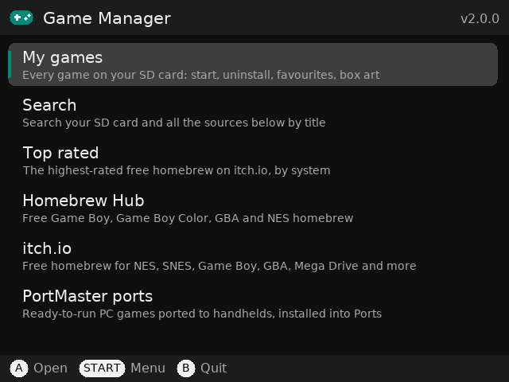
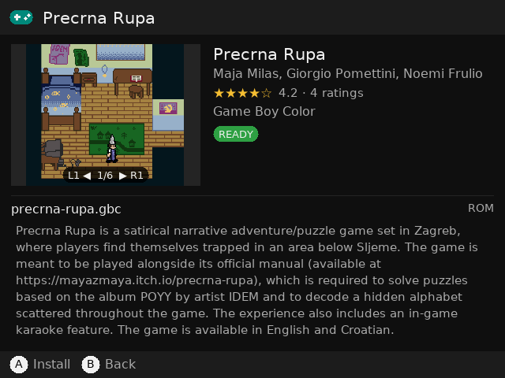
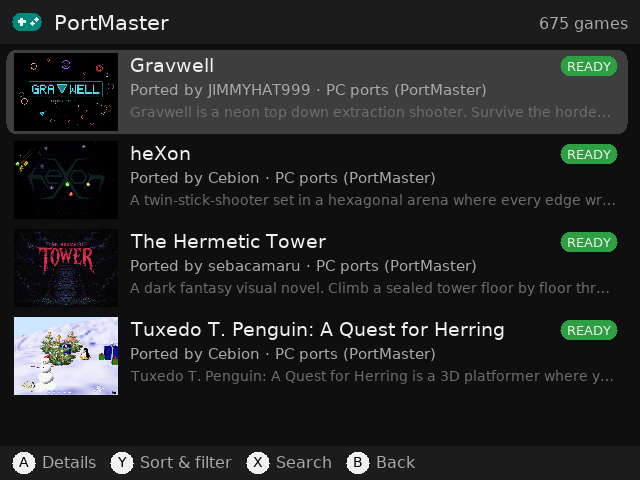
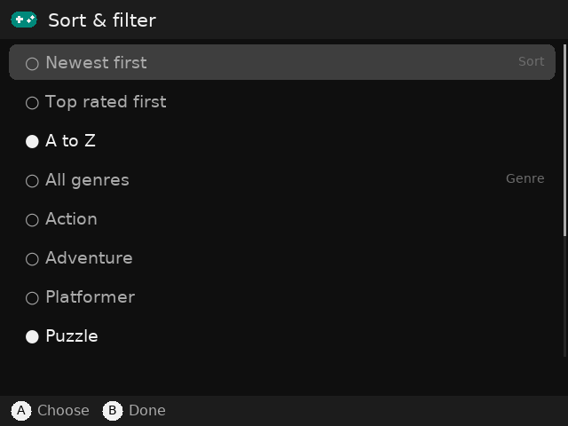
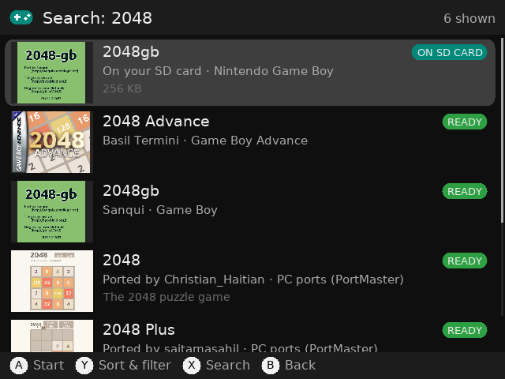
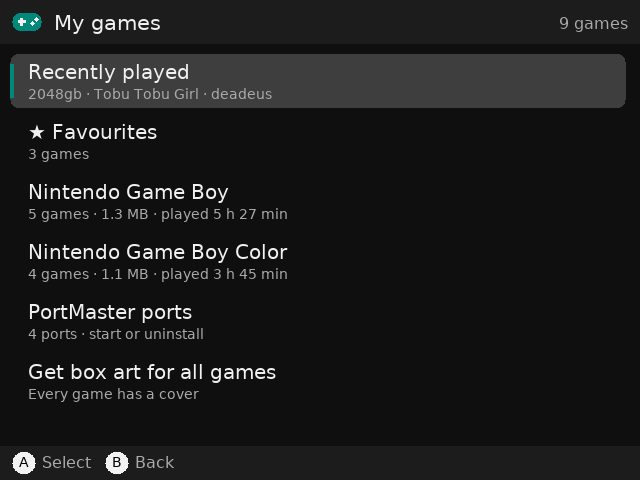
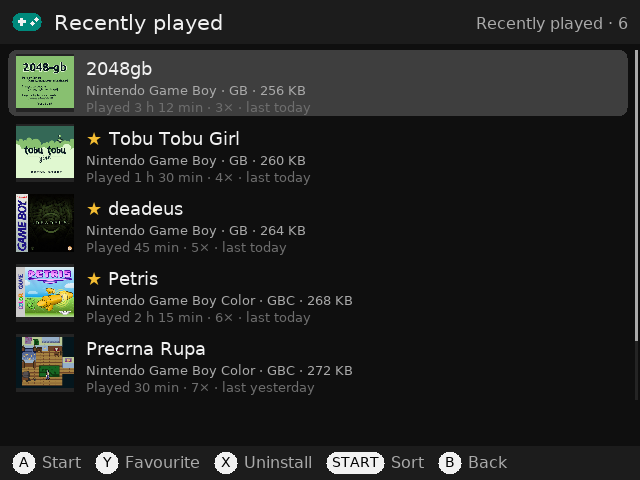
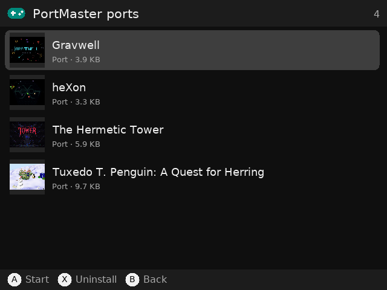

# Game Manager

**Find, install and manage free homebrew games on muOS handhelds**, from Homebrew Hub, itch.io and PortMaster, right on
the game console. Checks each game can run on your device before installing it.

[Download](https://pocketkode.com/apps/game-manager/) · [Guide](https://pocketkode.com/apps/game-manager/#guide) ·
[Blog: install free homebrew games](https://pocketkode.com/blog/install-free-homebrew-games-muos-game-manager/) ·
[pocketkode.com](https://pocketkode.com)

***

- **Three sources:** Homebrew Hub (Game Boy, Game Boy Color, GBA and NES homebrew), itch.io (homebrew for NES, SNES,
  Game Boy, GBA, Mega Drive and more, plus your own library) and PortMaster ports.
- **Checks every game** before and after downloading, and installs it into the ROM folders muOS already uses, with box
  art and a description. Broken files and PC-only builds never reach your SD card.
- **Search** your SD card and all the sources at once: games you already have come first, marked ON SD CARD.
- **My games:** every game on your SD cards by system, with play time, favourites, box art and a PortMaster ports shelf.
- **Try it** straight after installing, and a **panic exit**: hold SELECT + START to quit a stuck game.
- **9 languages:** English, 日本語, Español, Français, Deutsch, Nederlands, Русский, 简体中文 and 한국어.

## Gallery

| | |
|---|---|
|  |  |
|  |  |
|  |  |
|  |  |

## Installation

1. Download `GameManager-X.Y.Z.muxapp` from **[pocketkode.com/apps/game-manager](https://pocketkode.com/apps/game-manager/)**
   (or from the [latest release](https://github.com/pocketkode/game-manager/releases/latest) here). The SHA-256 is on
   both pages.
2. Copy it to the `ARCHIVE` folder on SD card 1 (with a card reader, or over Wi-Fi with
   [Wi-Fi Transfer](https://pocketkode.com/apps/wifi-transfer/)).
3. On the handheld, open **Applications → Archive Manager** and install it. Then open **Applications → Game Manager**.

New to `.muxapp` files? See [Install apps on muOS with Archive Manager](https://pocketkode.com/blog/install-apps-muos-archive-manager-muxapp/).

Tested on the Anbernic RG40XXH with muOS 2601.0 Jacaranda.

## Quick start

1. Turn on Wi-Fi in muOS and check that the **date and time** are right.
2. Open **Applications → Game Manager**. **A** opens, **B** goes back, **START** opens Settings.
3. **Find a game:** open Homebrew Hub, itch.io, Top rated or PortMaster ports and pick a system. **Y** sorts and
   filters, **X** searches. **READY** means a game runs on your handheld; **NO EMU** means it doesn't.
4. **Install and play:** open a game and press **A** to install it. Press **Y** to try it straight away; it's in the muOS
   game list too. When you're done, tell Game Manager whether it worked.
5. **My games:** **A** start · **Y** favourite · **X** uninstall · **START** sort. **Get box art for all games** adds the
   missing covers. Uninstalling never deletes your saves.

The full guide with pictures is on **[pocketkode.com/apps/game-manager](https://pocketkode.com/apps/game-manager/#guide)**.

## Tips

- **itch.io downloads** need your own free API key; you set it up once. Create one at
  [itch.io/user/settings/api-keys](https://itch.io/user/settings/api-keys), then open **START → Settings → itch.io API key**
  and type it in. With a key you also get **My itch.io library** (games you claimed or bought).
- **Quit a stuck game:** hold **SELECT + START** for 2 seconds. This works for games you start from Game Manager. The
  buttons and the time are set by `exit_combo` and `exit_hold` in `config.ini`.
- **Updates:** when a new version is out, **Update available** appears on the home screen. Press **A** to update; your
  games and settings stay. You can switch the check off in **START → Settings**.
- **Settings file:** every option in `config.ini` is explained in `config.ini.example`.
- Not sure what to play? See [the best free homebrew games for the RG40XXH](https://pocketkode.com/blog/best-free-homebrew-games-rg40xxh-muos/).

## Troubleshooting

| Problem | What to do |
|---|---|
| No internet connection | Turn on Wi-Fi in muOS. |
| Secure connection failed | Set the correct date and time in muOS. |
| A game closes straight away | Choose another core for it in muOS. |
| Still stuck? | Email **feedback@pocketkode.com** with `logs/app.log` from the app's folder, or open an [issue](https://github.com/pocketkode/game-manager/issues). |

## Privacy

Game Manager never reads or sends your saves, screenshots or files, and doesn't track what you play. For updates it
reads the latest release on GitHub (switchable in **START → Settings**), and an update you choose to install is
downloaded from pocketkode.com and checked (SHA-256 and PocketKode's signature); it sends nothing about you or the handheld.
To list and download games it connects to Homebrew Hub, itch.io, PortMaster (GitHub) and the libretro box-art library;
your searches go to those sites, and your itch.io API key only to itch.io. No ads, no analytics, no tracking.
More on [pocketkode.com/privacy](https://pocketkode.com/privacy/).

## Build

`bash build.sh` (needs bash, curl, unzip, zip, python3 and Docker) produces `dist/GameManager.muxapp`: the app's
modules compiled to native modules for muOS's Python 3.11 (Cython, in the container from `compile/`), plus PySDL2 and
the fonts. The package's `NOTICE` says where the source of that exact version is (its tag here). The app uses the
Python 3 and SDL2 that come with muOS.

## Third-party components

Bundled in the package, each under its own license (texts in the `licenses/` folder):

- **PySDL2** ([py-sdl/py-sdl2](https://github.com/py-sdl/py-sdl2)), © Marcus von Appen, CC0 or zlib: Python bindings
  for SDL2, bundled unmodified in `deps/sdl2/`.
- **DejaVu Sans** ([dejavu-fonts](https://dejavu-fonts.github.io/)), Bitstream Vera Fonts license: Latin and Cyrillic
  letters and symbols.
- **Noto Sans JP, SC and KR** ([notofonts/noto-cjk](https://github.com/notofonts/noto-cjk)), © Adobe and Google, SIL
  Open Font License 1.1: the fonts for Japanese, Chinese and Korean.

Fetched on your handheld when you ask, not bundled: game listings and files from [Homebrew Hub](https://hh3.gbdev.io),
[itch.io](https://itch.io) and [PortMaster](https://portmaster.games), and box art from the
[libretro thumbnail library](https://thumbnails.libretro.com). Games belong to their creators and come with their own
licenses.

## Acknowledgments

- The homebrew developers who make and share free games for old consoles and handhelds.
- [Homebrew Hub](https://hh3.gbdev.io) and the [gbdev](https://gbdev.io) community, for the open homebrew archive and its API.
- [itch.io](https://itch.io), for its API and for hosting so many free homebrew games.
- The [PortMaster](https://portmaster.games) team, for bringing PC games to handhelds.
- [libretro](https://www.libretro.com), for the thumbnail library.
- The [muOS](https://muos.dev) team, for the system Game Manager runs on.
- Everyone who reports bugs and ideas.

Game Manager is an independent project, not affiliated with or endorsed by any of them, or by Anbernic.

## License

© 2026 PocketKode. Game Manager is free software under the **GNU General Public License v3** (GPL-3.0-only): you may
use, study, change and share it under that license; see [LICENSE](LICENSE) and [NOTICE](NOTICE). Bundled third-party parts keep their own
licenses (see the `licenses/` folder).

The name "PocketKode", the name "Game Manager" as used by PocketKode, and the PocketKode and app icons are not covered
by the GPL. If you share a changed version, please give it a different name and icon.

Bug reports and ideas: **feedback@pocketkode.com** · [pocketkode.com](https://pocketkode.com)
